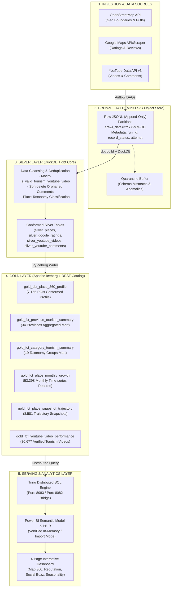
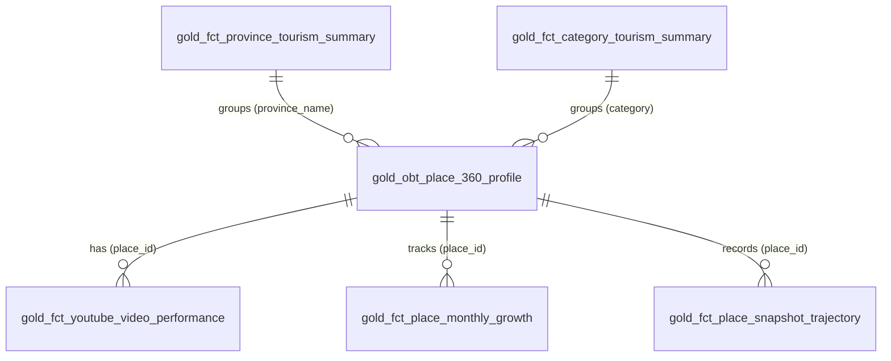

# 🏛️ Vietnam Tourism Data Lakehouse: Multi-source Social & Geospatial Analytics

<div align="center">

[](https://www.docker.com/)
[](https://iceberg.apache.org/)
[](https://www.getdbt.com/)
[](https://airflow.apache.org/)
[](https://trino.io/)
[](https://powerbi.microsoft.com/)
[](https://min.io/)
[](https://duckdb.org/)
[](https://www.python.org/)

**Đề tài:** Xây dựng Data Lakehouse phục vụ lưu trữ và phân tích dữ liệu du lịch từ mạng xã hội  
*(Building a Data Lakehouse for Ingesting, Storing, and Analyzing Tourism Data from Social Media)*

</div>

---

## 1. Tổng quan Đề tài

### 1.1. Bối cảnh & Thách thức (Problem Statement)
Ngành du lịch Việt Nam đang chứng kiến sự bùng nổ mạnh mẽ về mặt thông tin, tuy nhiên dữ liệu du lịch hiện nay đang đối mặt với các rào cản kỹ thuật lớn:
- **Phân tán & Dị thể (Siloed & Heterogeneous)**: Dữ liệu tọa độ không gian tĩnh (OpenStreetMap) hoàn toàn tách rời với dữ liệu phản hồi động từ du khách trên mạng xã hội (Google Maps, YouTube).
- **Rác & Nhiễu ngữ nghĩa (Noisy Data)**: Quá trình thu thập từ mạng xã hội dễ bị xâm nhập bởi nội dung giải trí, video ca nhạc (MV viral), game show không liên quan đến du lịch.
- **Hạn chế của kiến trúc kho truyền thống**: RDBMS/Data Warehouse truyền thống tốn kém, không tối ưu cho dữ liệu bán cấu trúc (JSONL) và không hỗ trợ Time-Travel hay ACID Transactions trên quy mô lớn.

### 1.2. Giải pháp
Đề tài xây dựng một nền tảng **Modern Data Lakehouse** toàn diện:
- **Kiến trúc Medallion (Bronze $\rightarrow$ Silver $\rightarrow$ Gold)** đảm bảo chất lượng dữ liệu qua từng chặng xử lý.
- **Tách rời hoàn toàn Storage & Compute**: Lưu trữ bảng mở với **Apache Iceberg + MinIO S3**, truy vấn SQL phân tán với **Trino Engine**.
- **Data Quality Gates 4 lớp**: Cơ chế Hard-Gate chặn đứng video ca nhạc rác, loại bỏ 100% comment mồ côi.
- **Phục vụ phân tích đa chiều (Serving Layer)**: Trực quan hóa tương tác 360° trên **Power BI PBIR/TMDL** với mô hình Star Schema chuẩn doanh nghiệp.

---

## 2. Kiến trúc Hệ thống



---

## 3. Technology Stack

| Phân tầng | Công nghệ | Phiên bản | Vai trò & Mục đích sử dụng |
| :--- | :--- | :--- | :--- |
| **Storage Layer** | **MinIO** | Latest (S3) | Object storage phân tán lưu trữ toàn bộ hồ dữ liệu Bronze, Silver, Gold. |
| **Table Format** | **Apache Iceberg** | 3.5.0 | Định dạng bảng mở chuẩn ACID, hỗ trợ Time-travel, Schema Evolution và Snapshot Isolation. |
| **Catalog** | **Lakekeeper** | Latest (Rust) | REST Catalog quản trị bảng Iceberg hiệu năng cao bằng ngôn ngữ Rust. |
| **Transformation** | **dbt Core + DuckDB** | 1.8+ | Công cụ chuyển đổi dữ liệu (ELT), kiểm thử data quality rules và sinh data lineage tự động. |
| **Orchestration** | **Apache Airflow** | 2.8+ | Điều phối toàn trình (Scheduling, Retries, Backfill, Ingestion DAGs). |
| **Query Engine** | **Trino** | 442+ | Engine truy vấn SQL phân tán liên kết trực tiếp vào hồ Iceberg với độ trễ thấp. |
| **Serving & BI** | **Microsoft Power BI** | PBIR (TMDL) | Xây dựng mô hình Semantic Star Schema, đo lường DAX và trực quan hóa tương tác 360°. |
| **Data Quality** | **Bayesian Formula** | Custom | Tính toán điểm uy tín có trọng số chống hiện tượng thiên lệch đánh giá (Rating Bias). |

---

## 4. Data Scale & Scope

Hệ thống được vận hành và kiểm thử trên tập dữ liệu du lịch thực tế tại Việt Nam:

- **Phạm vi địa lý**: **34 Tỉnh/Thành phố** trọng điểm du lịch trên cả 3 miền Bắc - Trung - Nam.
- **Địa điểm du lịch (POIs)**: **7.155 địa điểm** chuẩn hóa từ OpenStreetMap, phân loại vào **19 nhóm danh mục**.
- **Đánh giá Google Maps**: **4.800.000+ lượt review** phục vụ tính toán chỉ số Bayesian Weighted Rating và ma trận uy tín.
- **Nội dung Video YouTube**: **30.677 video du lịch chính quy** đã được kiểm định qua bộ lọc Hard-Gate.
- **Bình luận YouTube**: **156.642 bình luận** đã được lọc sạch ngữ nghĩa, phục vụ phân tích cảm xúc cộng đồng.
- **Dữ liệu Chu kỳ Mùa vụ**: **53.398 bản ghi chuỗi thời gian hàng tháng** theo dõi động lực tăng trưởng.

---

## 5. Medallion Data Architecture & Modeling

### 5.1. Bronze Layer (Raw & Immutable)
- Lưu trữ append-only theo định dạng `JSONL` nén trên MinIO:
  `s3://lakehouse/bronze/{dataset}/crawl_date=YYYY-MM-DD/part-{run_id}.jsonl`
- Gắn kèm metadata quản trị: `run_id`, `source`, `source_id`, `ingested_at_utc`, `pipeline_version`, `record_status`.
- Dữ liệu sai cấu trúc hoặc không đạt ngưỡng cơ bản được tự động đưa vào phân vùng `quarantine/`.

### 5.2. Silver Layer (Cleaned & Conformed)
- Chuẩn hóa kiểu dữ liệu, loại bỏ trùng lặp (deduplication) bằng dbt incremental & snapshot logic.
- Áp dụng macro `is_valid_tourism_youtube_video.sql` loại bỏ hoàn toàn các video ca nhạc và comment mồ côi (orphaned comments).

### 5.3. Gold Layer (Star Schema Marts)



1. **`gold_obt_place_360_profile`** *(Dimension / Profile Table - 7,155 rows)*: Bảng One-Big-Table tổng hợp toàn bộ thuộc tính không gian, phân loại, điểm Google Maps, Bayesian Weighted Rating và tổng view YouTube theo từng POI.
2. **`gold_fct_province_tourism_summary`** *(Aggregated Mart - 34 rows)*: Tổng hợp năng lực du lịch, mật độ địa điểm, độ hài lòng trung bình theo 34 tỉnh thành.
3. **`gold_fct_category_tourism_summary`** *(Aggregated Mart - 19 rows)*: Thống kê hiệu suất theo 19 nhóm danh mục du lịch.
4. **`gold_fct_place_monthly_growth`** *(Time-series Fact - 53,398 rows)*: Dữ liệu phân tích tăng trưởng và chu kỳ mùa vụ du lịch theo tháng.
5. **`gold_fct_place_snapshot_trajectory`** *(Trajectory Fact - 8,581 rows)*: Quỹ đạo dịch chuyển xếp hạng và trạng thái vận hành của các địa điểm.
6. **`gold_fct_youtube_video_performance`** *(Social Fact - 30,677 rows)*: Hiệu suất truyền thông mạng xã hội (views, likes, comments, sentiment, engagement rate).

---

## 6. Power BI Dashboard

Dashboard được thiết kế theo chuẩn **Power BI Project (PBIR / TMDL)** kết nối trực tiếp vào Trino Lakehouse:

| Trang báo cáo | Trọng tâm Phân tích | Các chỉ số & Visual chính |
| :--- | :--- | :--- |
| **Page 1: Toàn cảnh Không gian 360°** | Tổng quan địa lý 34 tỉnh thành & cơ cấu loại hình | Bản đồ phân bổ POI, Ma trận năng lực du lịch tỉnh/thành, Tỷ trọng 19 nhóm danh mục. |
| **Page 2: Uy tín & Mức độ Hài lòng** | Đánh giá thực tế từ 4,8M review Google Maps | Điểm trung bình vs **Bayesian Weighted Rating**, Top địa điểm được đánh giá cao nhất, Phân bố sao (1★ - 5★). |
| **Page 3: Sức lan tỏa Mạng xã hội** | Truyền thông số từ 30.677 YouTube Vlogs & 156K comments | Tổng lượt xem (views), Tỷ lệ tương tác (Engagement Rate), Phân tích cảm xúc người xem, Date Range Slicer. |
| **Page 4: Động lực Tăng trưởng & Mùa vụ** | Phân loại điểm đến & nhận diện chu kỳ du lịch | Phân khúc điểm đến (*Leading Hotspots, Rising Stars, Stable Anchors, Hidden Gems*), Dao động mùa vụ theo tháng. |

---

## 7. Cấu trúc thư mục

```text
vietnam-tourism-lakehouse/
├── airflow/                        # Cấu hình Apache Airflow & Pipeline DAGs
│   └── dags/                       # DAGs: reference backfill, social crawl, dbt transformations
├── data/                           # Hồ dữ liệu cục bộ & Export Parquet (được gitignore)
│   ├── bronze/                     # Phân vùng Raw JSONL theo ngày cào
│   ├── duckdb/                     # Tourism Lakehouse DuckDB database
│   └── gold_export/                # 6 bảng Gold Parquet phục vụ Power BI Offline
├── docs/                           # Tài liệu thiết kế hệ thống, data dictionary & business questions
├── iceberg/                        # PyIceberg Catalog & Data Sync scripts
│   ├── catalog.py                  # Cấu hình REST Catalog kết nối Lakekeeper
│   ├── check_table.py              # Script kiểm tra snapshot & tính toàn vẹn Iceberg
│   └── writer.py                   # Ghi dữ liệu từ DuckDB vào Apache Iceberg
├── powerbi/                        # Mã nguồn báo cáo Power BI PBIR & Semantic Model
│   ├── test.Report/                # Báo cáo PBIR (JSON visuals, pages, layouts)
│   ├── test.SemanticModel/         # Mô hình dữ liệu TMDL (Tables, Measures, Relationships)
│   ├── Vietnam_Tourism_Lakehouse.pbip # Power BI Project File
│   └── Vietnam_Tourism_Theme.json  # Theme màu sắc chuẩn phong cách Flat Modern
├── script/                         # Mã nguồn cốt lõi các crawler dữ liệu
│   ├── alerts/                     # Webhook thông báo lỗi hệ thống qua Discord
│   └── crawl_data/                 # Trình cào OSM, Google Maps Ratings, Reviews & YouTube Vlogs
├── tools/                          # Các công cụ vận hành & bảo trì hệ thống (DataOps/DevOps)
│   ├── export_gold_to_parquet.py   # Xuất 6 bảng Gold ra file .parquet dự phòng
│   ├── rebuild_lakehouse_after_crawl.py # Pipeline tái tạo tự động toàn trình Lakehouse
│   ├── trigger_crawl.py            # Tiện ích dòng lệnh kích hoạt nhanh Airflow DAG
│   └── README.md                   # Hướng dẫn chi tiết sử dụng thư mục tools
├── tourism_dbt/                    # Project dbt biến đổi dữ liệu (Models, Macros, Tests)
│   ├── macros/                     # Macro dbt: lọc video du lịch, kiểm tra chất lượng
│   ├── models/                     # Mô hình Silver và Gold Marts
│   └── dbt_project.yml             # Cấu hình project dbt
├── trino/                          # Cấu hình Trino Server & ODBC Bridge
│   ├── etc/                        # Catalog cấu hình Iceberg connector
│   └── odbc_bridge.py              # Trino ODBC Bridge service
├── docker-compose.yml              # Điều phối container (Airflow, MinIO, Trino, Lakekeeper, Postgres)
├── requirements.txt                # Các thư viện Python phụ thuộc
└── README.md                       # Tài liệu thuyết minh tổng quan dự án
```

---

## 8. Hướng dẫn Triển khai

### 8.1. Yêu cầu Tiền đề (Prerequisites)
- **Hệ điều hành**: Windows 10/11, macOS, hoặc Ubuntu Linux.
- **Docker Desktop** (bật WSL2 nếu dùng Windows) & **Docker Compose**.
- **Python 3.11+** và **Power BI Desktop** (đã bật tính năng *PBIR format*).

### 8.2. Cài đặt & Khởi động Hệ thống
1. **Clone repository:**
   ```bash
   git clone https://github.com/hoangphuonglxag/vietnam-tourism-lakehouse.git
   cd vietnam-tourism-lakehouse
   ```

2. **Cấu hình biến môi trường:**
   ```bash
   cp .env.example .env
   # Điền thông tin YouTube API Key và thông tin kết nối MinIO nếu cần
   ```

3. **Khởi chạy cụm hạ tầng Docker:**
   ```bash
   docker compose up -d
   ```

4. **Kiểm tra trạng thái các dịch vụ:**
   - **Apache Airflow Webserver**: [http://localhost:8080](http://localhost:8080) (`airflow` / `airflow`)
   - **MinIO Console (S3 Object Store)**: [http://localhost:9001](http://localhost:9001) (`lakehouse_admin` / `minIO123`)
   - **Trino Distributed Query UI**: [http://localhost:8083](http://localhost:8083)

### 8.3. Thực thi Pipeline Toàn trình (End-to-End Rebuild)
Bạn có thể tái tạo toàn bộ dữ liệu từ Silver $\rightarrow$ Gold $\rightarrow$ Iceberg $\rightarrow$ Parquet chỉ với 1 lệnh:
```bash
python tools/rebuild_lakehouse_after_crawl.py
```

### 8.4. Mở Báo cáo Trực quan trên Power BI
1. Cài đặt **Trino ODBC Driver 64-bit** (file `TrinoODBC_x64.msi`).
2. Mở file [powerbi/Vietnam_Tourism_Lakehouse.pbip](file:///D:/PJ/vietnam-tourism-lakehouse/powerbi/Vietnam_Tourism_Lakehouse.pbip) bằng **Power BI Desktop**.
3. Nhấn nút **Refresh** trên thanh công cụ để đồng bộ dữ liệu mới nhất từ động cơ VertiPaq.

---

## 9. Author & Academic Context

Đồ án được thực hiện trong khuôn khổ môn học **Đồ án Tiểu luận Chuyên ngành / Khóa luận Tốt nghiệp ngành Kỹ thuật Dữ liệu (Data Engineering)**.
- **Trường:** Đại học Công nghệ Kỹ thuật TP.HCM
- **Khoa:** Công nghệ Thông tin
- **Giảng viên hướng dẫn:** TS. Phan Thị Thể
- **Sinh viên thực hiện:**
  - Đinh Hoàng Phương (MSSV: 23133059)
  - Nguyễn Vũ Minh    (MSSV: 23133044)

## 10. Tài liệu tham khảo

### 1. Kiến trúc Data Lakehouse & Table Format
1. **Armbrust, M., Ghodsi, A., Xin, R., & Zaharia, M.** (2021). *Lakehouse: A New Generation of Open Platforms that Unify Data Warehousing and Advanced Analytics*. Proceedings of the VLDB Endowment (CIDR 2021).
2. **Apache Software Foundation.** (2024). *Apache Iceberg: The Open Table Format for Huge Analytic Datasets*. [https://iceberg.apache.org/](https://iceberg.apache.org/)
3. **Sethi, R., et al.** (2019). *Presto: SQL on Everything*. IEEE 35th International Conference on Data Engineering (ICDE). (Tiền thân của Trino Distributed SQL Engine).

### 2. Mô hình hóa Dữ liệu & Kỹ thuật Chuyển đổi
4. **Kimball, R., & Ross, M.** (2013). *The Data Warehouse Toolkit: The Definitive Guide to Dimensional Modeling (3rd Edition)*. John Wiley & Sons. *(Cơ sở lý thuyết thiết kế mô hình Star Schema và One Big Table tầng Gold)*.
5. **dbt Labs.** (2024). *Best Practices in Analytics Engineering: Building Conformed Dimensions and Incremental Models*. [https://docs.getdbt.com/](https://docs.getdbt.com/)

### 3. Phương pháp Thuật toán & Đánh giá Dữ liệu Mạng xã hội
6. **Bayes, T., & Price, R.** (1763). *An Essay towards Solving a Problem in the Doctrine of Chances*. Philosophical Transactions of the Royal Society of London. *(Cơ sở công thức Bayesian Weighted Rating áp dụng triệt tiêu thiên lệch đánh giá Google Maps)*.
7. **Baccianella, S., Esuli, A., & Sebastiani, F.** (2010). *SentiWordNet 3.0: An Enhanced Lexical Resource for Sentiment Analysis and Opinion Mining*. LREC. *(Cơ sở lý thuyết phân tích cảm xúc bình luận du lịch)*.

### 4. Nguồn Dữ liệu Mở & API Tham chiếu
8. **OpenStreetMap Foundation.** (2024). *OpenStreetMap Geographic Point of Interest (POI) Taxonomy and Overpass API Specification*. [https://wiki.openstreetmap.org/](https://wiki.openstreetmap.org/)
9. **Google Cloud.** (2024). *YouTube Data API v3 Documentation: Video Performance & Comment Threads*. [https://developers.google.com/youtube/v3](https://developers.google.com/youtube/v3)
