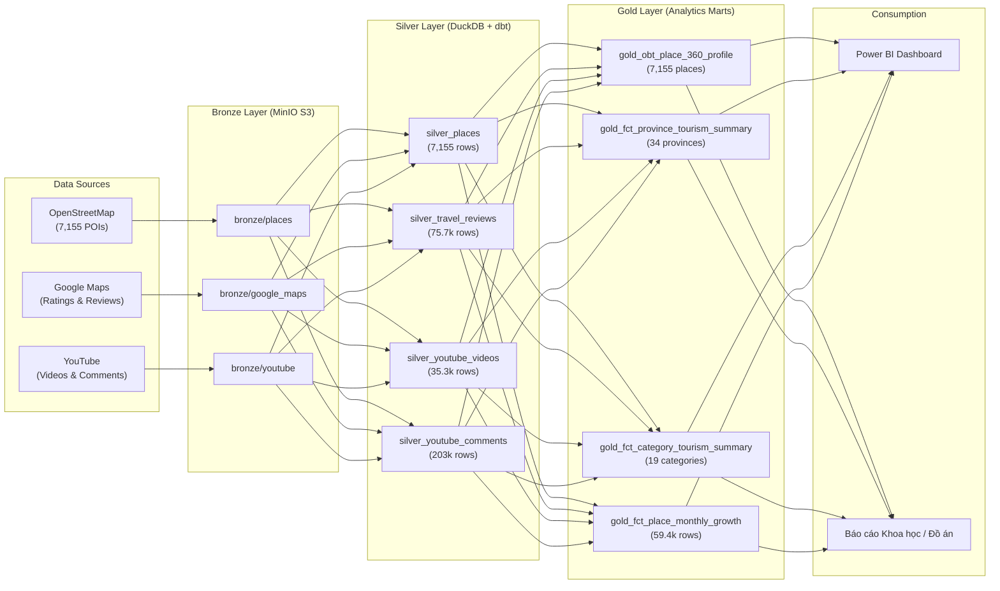

# KHUNG SƯỜN PHÂN TÍCH DỮ LIỆU DU LỊCH VIỆT NAM (34 TỈNH THÀNH)
## Vietnam Tourism Lakehouse: Multi-source Social & Geographical Intelligence

---

## 1. TỔNG QUAN KIẾN TRÚC DỮ LIỆU & QUY MÔ DỰ ÁN

Dự án **Vietnam Tourism Lakehouse** đã hoàn thiện toàn diện kiến trúc **Medallion Architecture (Bronze - Silver - Gold)** tích hợp công nghệ **Apache Iceberg + DuckDB + dbt + Apache Airflow + MinIO S3**, mở khóa phạm vi phân tích trên **34 tỉnh thành trọng điểm** của cả 3 miền Bắc - Trung - Nam.



### Chỉ số Quy mô Dữ liệu Hiện hữu (Gold Layer Ready)
* **Phạm vi Địa lý**: 34 tỉnh thành (Đà Nẵng, Lâm Đồng, TP.HCM, Hà Nội, Khánh Hòa, Ninh Bình, Huế, Quảng Trị, Hải Phòng...).
* **Địa điểm Du lịch (POIs)**: **7,155 địa điểm** (trong đó có **1,763 điểm du lịch cốt lõi** - `crawl_eligible = True`).
* **Phân loại Du lịch (Taxonomy)**: **19 danh mục** chi tiết (Danh thắng thiên nhiên, Di tích lịch sử - văn hóa, Du lịch tâm linh, Ẩm thực & Chợ truyền thống, Resort & Nghỉ dưỡng biển...).
* **Đánh giá Google Maps (Reviews)**: **75,727 bài đánh giá** chi tiết kèm nội dung và phân loại cảm xúc (file tổng hợp lịch sử đã chạm mốc **88,647 dòng**).
* **Đo lường Đánh giá (Rating Snapshots)**: **8,581 snapshots** điểm số 1 - 5 sao.
* **Truyền thông Mạng xã hội (YouTube Videos)**: **35,371 videos** du lịch.
* **Tương tác Cộng đồng (YouTube Comments)**: **203,015 bình luận** thảo luận đa chiều.
* **Chu kỳ Tăng trưởng (Monthly Growth Records)**: **59,395 bản ghi** biến động theo tháng.

---

## 2. NĂM TRỤC PHÂN TÍCH DỮ LIỆU TRỌNG TÂM (CORE ANALYTICAL PILLARS)

### TRỤC 1: Bản đồ Nhiệt & Chỉ số Sức hút Du lịch Cấp Tỉnh (Provincial Tourism Magnetism)
* **Mục tiêu**: Định lượng và xếp hạng sức hút du lịch của 34 tỉnh thành dựa trên tổ hợp đa nguồn (Địa điểm, Lượng quan tâm số, Tương tác video).
* **Các chỉ số phân tích chính**:
  1. **National Tourism Rank**: Xếp hạng tổng thể dựa trên `total_places_count`, `active_places_count`, `total_youtube_views` và `total_crawled_review_count`.
  2. **Tương quan Cung - Cầu Số**:
     - *Cung (Supply)*: Số lượng địa điểm du lịch được số hóa trên bản đồ.
     - *Cầu (Demand)*: Tổng lượt xem video YouTube và số bài đánh giá trải nghiệm thực tế.
  3. **Phân nhóm Tỉnh thành theo Cụm Vùng (Clustering)**:
     - *Nhóm Hạt nhân Du lịch Quốc gia (Top Tier)*: Đà Nẵng, Lâm Đồng (Đà Lạt), Khánh Hòa (Nha Trang), Hà Nội, TP.HCM, Thừa Thiên Huế.
     - *Nhóm Di sản & Khám phá Tiềm năng cao (High Potential Cultural/Nature)*: Ninh Bình, Quảng Trị, Lào Cai (Sa Pa), Quảng Ngãi (Lý Sơn), Hải Phòng (Cát Bà).
     - *Nhóm Du lịch Vệ tinh / Mới nổi (Emerging Satellite Destinations)*: An Giang, Bắc Ninh, Bình Định, Kiên Giang...

---

### TRỤC 2: Hồ sơ 360° Địa điểm & Ma trận Định vị POI (Place 360° Profile & Quadrant Matrix)
* **Mục tiêu**: Bóc tách chi tiết từng địa điểm du lịch để tìm ra quy luật giữa chất lượng dịch vụ thực tế và mức độ phủ sóng truyền thông.
* **Ma trận Định vị 4 Phân khúc (The 4-Quadrant Positioning Matrix)**:
  ```
  Lượt xem & Video YouTube (Digital Visibility)
           ^
           |   [QUADRANT II: RISING STARS / HYPE]       [QUADRANT I: NATIONAL ICONIC HOTSPOTS]
           |   - Video triệu view, viral mạnh            - Rating cao (4.5 - 5.0)
           |   - Rating trung bình (chất lượng cần test)  - Lượng view & review bùng nổ
           |   - Điểm check-in giới trẻ, quán cafe mới   - Ví dụ: Bà Nà Hills, Hồ Gươm, Chợ Đà Lạt
           |
           +---------------------------------------------> Điểm đánh giá Google Maps (Quality Rating)
           |
           |   [QUADRANT III: SPARSE / UNDER-THE-RADAR]  [QUADRANT IV: HIDDEN GEMS / HIGH QUALITY]
           |   - Ít bài review, ít video                 - Rating cực cao (4.6 - 5.0 sao)
           |   - Điểm đến địa phương, chưa số hóa mạnh   - Thiếu truyền thông số & video quảng bá
           |   - Cần kích hoạt quảng bá ban đầu          - Tiềm năng phát triển du lịch sinh thái
  ```
* **Bóc tách Top Danh mục**:
  - So sánh mức độ hài lòng (`avg_rating`) giữa *Du lịch Thiên nhiên* vs *Du lịch Văn hóa/Lịch sử* vs *Du lịch Đô thị/Ẩm thực*.

---

### TRỤC 3: Sức lan tỏa Mạng Xã hội & Phân tích Tương tác YouTube (Social Media Virality)
* **Mục tiêu**: Đo lường tác động của nội dung video (Vloggers, Reviewers) tới hành vi du lịch.
* **Các chỉ tiêu bóc tách từ 35,371 videos và 203k comments**:
  1. **Hiệu suất Video (Video Performance Metrics)**:
     - Tỷ lệ tương tác (`Engagement Rate = (likes + comments) / views`).
     - Tần suất xuất bản video theo năm/tháng cho từng cụm địa điểm.
  2. **Tiếng nói Cộng đồng qua Bình luận (Community Voice)**:
     - Chủ đề thảo luận phổ biến: Giá cả, thái độ phục vụ, kinh nghiệm di chuyển, thời điểm lý tưởng, vệ sinh môi trường.
     - Mức độ quan tâm của du khách quốc tế (thông qua tỷ lệ comment đa ngôn ngữ).

---

### TRỤC 4: Xu hướng Biến động Chu kỳ & Tính Mùa vụ (Seasonal Trajectory & Monthly Growth)
* **Mục tiêu**: Phát hiện chu kỳ mùa vụ du lịch của Việt Nam qua 59,395 bản ghi dữ liệu tăng trưởng theo tháng (`gold_fct_place_monthly_growth`).
* **Các câu hỏi trả lời bằng dữ liệu**:
  1. *Tính chu kỳ du lịch theo Quý (Quarterly Seasonality)*:
     - **Quý 1 (Tết & Lễ hội đầu xuân)**: Tăng đột biến tại các điểm Du lịch Tâm linh (Chùa Bái Đính, Chùa Hương, Miếu Bà Chúa Xứ).
     - **Quý 2 - Quý 3 (Hè biển đảo & Tránh nóng)**: Đạt đỉnh tại Đà Nẵng, Nha Trang, Phú Quốc, Đà Lạt, Cát Bà.
     - **Quý 4 (Mùa thu - đông miền Bắc & Du lịch nghỉ dưỡng)**: Khởi sắc tại Hà Nội, Sa Pa, Ninh Bình, Tây Bắc mùa hoa.
  2. *Chỉ số Tăng trưởng Net Sentiment theo tháng*:
     - Sự biến động của mức độ hài lòng vào các mùa cao điểm (quá tải dịch vụ, giá cả leo thang) so với mùa thấp điểm.

---

### TRỤC 5: Phân tích Cảm xúc & Hệ thống Cảnh báo Sớm (Sentiment Intelligence & Quality Early-Warning)
* **Mục tiêu**: Xây dựng cơ chế phát hiện sớm những địa điểm có dấu hiệu suy giảm chất lượng dịch vụ hoặc khủng hoảng truyền thông du lịch.
* **Phương pháp luận**:
  - **Net Sentiment Score (NSS)**: $\text{NSS} = \frac{\text{Positive} - \text{Negative}}{\text{Total Reviews}} \times 100\%$
  - **Early Warning Triggers**:
    - Địa điểm có NSS giảm liên tục trong 2 tháng liên tiếp.
    - Điểm đánh giá Google Maps giảm $\ge 0.3$ sao trong snapshot gần nhất.
    - Tỷ lệ từ khóa tiêu cực ("chặt chém", "bẩn", "thái độ kém", "thất vọng") tăng đột biến trong YouTube Comments.

---

## 3. KỊCH BẢN KỂ CHUYỆN DỮ LIỆU TRÊN POWER BI (DATA STORYTELLING)

| Tab / Dashboard Page | Trọng tâm Thể hiện | Biểu đồ Đề xuất | Dữ liệu Nguồn |
| :--- | :--- | :--- | :--- |
| **Page 1: Executive Overview** | Toàn cảnh 34 tỉnh, KPI tổng thể (Places, Reviews, Videos, Views) | KPI Cards, Filled Map 34 tỉnh, Bar Chart xếp hạng Top tỉnh | `gold_fct_province_tourism_summary` |
| **Page 2: Place 360° Explorer** | Tra cứu chi tiết từng điểm đến, phân loại danh mục, ma trận định vị | Scatter Plot (Rating vs Views), Matrix Table có search/filter | `gold_obt_place_360_profile` |
| **Page 3: Social & Sentiment Insights** | Tiếng nói du khách trên YouTube & Google, tỷ lệ cảm xúc, phân tích bình luận | Donut Chart (Sentiment Split), Bar Chart tương tác video theo tỉnh | `gold_fct_youtube_video_performance` |
| **Page 4: Seasonality & Growth Trends** | Biến động lượng quan tâm theo tháng/quý, dự báo nhịp du lịch | Line Chart (Monthly Growth Over Time), Heatmap Quý x Địa phương | `gold_fct_place_monthly_growth` |

---

## 4. KẾ HOẠCH HOÀN THIỆN ĐỒ ÁN & BÁO CÁO THỨ BẢY CHO GIẢNG VIÊN

1. **Khớp Số Liệu Power BI**:
   - Sử dụng các file Parquet sẵn có tại `data/gold_export/*.parquet` để trực quan hóa 4 trang Dashboard.
2. **Quản trị Mã Nguồn (Git Flow)**:
   - Tạo nhánh `feature/lakehouse-34-provinces-full-rebuild`.
   - Commit toàn bộ code mới: `sync_places_to_bronze.py`, `export_gold_to_parquet.py`, `rebuild_lakehouse_after_crawl.py`.
   - Mở Pull Request merge vào nhánh `develop`.
3. **Hoàn thiện Tài Liệu**:
   - Viết lại `README.md` chuyên nghiệp với đầy đủ sơ đồ kiến trúc, luồng ETL và hướng dẫn chạy Docker.
   - Cập nhật file `note.txt` phản ánh đúng quy mô 34 tỉnh thành đã hoàn thành.
